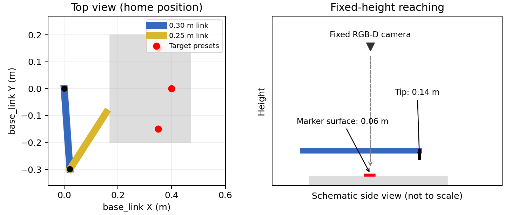

# HW1: Camera-Guided Reaching with a Two-Joint Arm

The PDF handout is generated automatically from the Markdown assignment
instructions and installation guide in the
[course repository](https://github.com/lifshitg/robotics-course-HW), and reproduces
their content.

Gilad Lifshitz will upload a short video explaining the assignment to Moodle.
We recommend watching it once it is available.

## Goal

Write your own ROS 2 Python implementation that detects the red marker in a
simulated camera image, reconstructs its position, transforms that position into
the robot base frame with TF2, and moves the arm tip above it using the provided
motion helper.

This assignment focuses on ROS communication, sensor data, coordinate frames, and
handling failures. You do not implement inverse kinematics or configure the joint
controllers. There is no grasping or obstacle-planning task.

## Before writing your solution

Follow [the installation guide](environment/README.md). Run the shared readiness
demo and `my_solution/check_setup.py`. Both must pass before you begin debugging
your assignment code. The student example demonstrates receiving image messages
and commanding one fixed point; it is not a target-reaching solution.

## Simulation

The fixed arm has two horizontal links, 0.30 m and 0.25 m long, with vertical
rotation axes. Its tip moves in the X/Y plane at a fixed height of 0.14 m. It cannot
change its height or independently set its orientation.

The target is a red marker on a low platform. Its top is at z=0.06 m in `base_link`.
Your desired tip position is 0.08 m above the detected marker, so its z coordinate
should be close to 0.14 m. The camera is fixed above the workspace and provides
aligned RGB and depth images plus calibration.

Each launch uses one stationary marker. Demonstrate all three target presets by
restarting the simulation with `preset:=1`, `preset:=2`, and `preset:=3`.

{width=95%}

## Interfaces

| ROS interface | Type |
| --- | --- |
| `/camera/image_raw` | `sensor_msgs/msg/Image` |
| `/camera/depth/image_raw` | `sensor_msgs/msg/Image` |
| `/camera/camera_info` | `sensor_msgs/msg/CameraInfo` |
| `/joint_states` | `sensor_msgs/msg/JointState` |
| `/clock` | `rosgraph_msgs/msg/Clock` |
| `/tf`, `/tf_static` | `tf2_msgs/msg/TFMessage` |
| `/hw01/measured_tip` | `geometry_msgs/msg/PoseStamped` |
| `/hw01/platform_contacts`, `/hw01/marker_contacts` | `ros_gz_interfaces/msg/Contacts` |
| `/hw01/move_to_point` | `hw01_interfaces/action/MoveToPoint` |

RGB and aligned depth are configured at 320×240 and 10 Hz. Depth uses `32FC1`
with values in metres. Camera info supplies the intrinsic matrix; joint states
contain measured shoulder/elbow positions and velocities. `/clock` supplies
simulation time, and TF supplies the arm and camera transforms.

The public observer uses `/hw01/measured_tip` from Gazebo physics and live
platform/marker contact samples, including empty samples. Missing streams fail
the check. These measurements are independent of the helper's action result.

Camera subscribers must support **best-effort sensor-data QoS**. Use the message
encodings and calibration instead of assuming raw byte layout or a hardcoded focal
length. Depth is distance along the camera optical Z axis, not pixel coordinates
or a Euclidean distance from the camera origin. Reject nonfinite, zero, negative,
and out-of-range depth values.

Frames follow these conventions:

- `base_link`: arm base; +X/+Y are horizontal and +Z points upward.
- `camera_link`: physical camera mount.
- `camera_optical_frame`: +X right in the image, +Y down, +Z forward through the lens.
- `tool0`: arm tip used for evaluating the final position.

Image and calibration headers identify the optical frame. Use TF2 to transform a
`PointStamped` with the image timestamp into `base_link`. Enable `use_sim_time`
for your node. Do not substitute a hand-written fixed transform or an unlabelled
point for this step.

## Required behavior

Build your own ROS package under `my_solution/` and implement:

1. Subscribe to RGB, aligned depth, and camera calibration. Match RGB/depth samples
   by their timestamps (within 0.05 simulated seconds).
2. Detect the marker's image location from its color. Account for missing or partly
   occluded targets and reject unreliable detections.
3. Reconstruct a 3D point in `camera_optical_frame` using valid marker depth and the
   intrinsic matrix. Describe your depth selection method in the report.
4. Transform the stamped point into `base_link` using TF2.
5. Add 0.08 m to its base-frame Z coordinate and send the point to the motion helper.
6. Report whether the motion succeeded. Only one motion may be active at a time.

Publish your estimated marker position (before the hover offset) as
`geometry_msgs/msg/PointStamped` on `/hw01/target_camera` and `/hw01/target_base`.
These topics help you explain and debug your result.

Never use hardcoded marker coordinates, the selected preset number, the simulator's
model pose, or world files to calculate your commanded target. The camera data is
your source for the marker position. Robot geometry is supplied for understanding
the environment; the helper handles its kinematics.

## Motion helper

See [my_solution/README.md](my_solution/README.md) for a short example.
`ArmClient.move_to_point(PointStamped)` returns a future whose result has
`success` and `message` fields. Keep spinning your ROS executor while waiting.
The helper internally solves IK and sends a smooth five-second joint trajectory.

Goals must be in `base_link`, contain finite coordinates, and have z within 0.01 m
of the fixed 0.14 m tip height. Unreachable, near-singular, joint-limit-violating,
and concurrent goals are rejected. Motion can fail if controllers or simulation
stop working. Action success is not a substitute for checking the physical result.

Do not send new goals from absent targets, invalid depth, unavailable transforms,
or stale observations. For this assignment, consider an observation stale if its
simulation timestamp is over 0.5 seconds old or no fresh camera data has arrived
for 2 wall-clock seconds. A missing observation must not reuse an earlier target.
Cancel pending motion when your node is interrupted.

## Public checks and success criteria

See [tests/README.md](tests/README.md). With the simulation running, start the reach
checker **before** starting your implementation:

```bash
ros2 run hw01_sim check_reach --preset 1
```

It observes the measured `tool0` pose on `/hw01/measured_tip` and live Gazebo
platform/marker contact streams. For the selected preset, the tip must remain
within **0.02 m** of the correct hover point for **2 simulated seconds**, with no
detected contact. Missing
contact data does not count as proof of a collision-free run. The checker does not
move the robot or implement perception.

Repeat for presets 2 and 3, restarting the simulation between demonstrations.
Use the same implementation in all runs.

## Deliverables and evaluation

Submit:

- Your own runnable ROS 2 package under `my_solution/`, with dependencies declared.
- `report.md`: explain detection, depth reconstruction, TF direction/timing, failure
  handling, and results for all three presets. Include your exact build/run commands.

The teaching staff will announce the deadline and any grading weights before release.

## Live demo

The live demo will take place approximately one week after the submission deadline.
The TA will post the meeting schedule. Each meeting lasts 10–15 minutes.

You will demonstrate your implementation live, explain your approach and results,
and answer questions about the theory and implementation. Have your simulation
and solution ready to run. Be prepared to explain your detection method, depth
reconstruction, message flow, coordinate frames, TF timing, and failure handling.

If you submit as a group, all group members must attend. Every member must be
ready to explain the work and answer questions about both the theory and
implementation.

## Submission

Follow the [repository submission process](../../README.md#submitting-an-assignment).
Use one `hw01` branch and one PR per student or group. Title it
`HW01 — Firstname Lastname` or `HW01 — Firstname Lastname, Firstname Lastname`.
Include all members' names and a link to your report. Staff
record the submitted commit at the deadline and close the PR without merging it.
