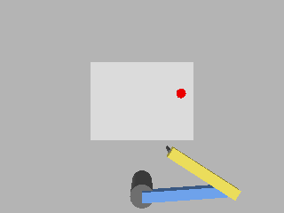
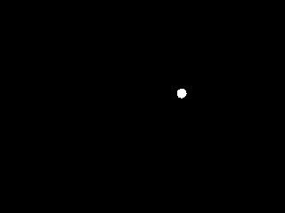

# HW1 report: camera-guided reaching

## Overview

The node `marker_reacher` (ROS package `hw01_reacher`) finds the red disc in each matched RGB-D pair, reconstructs its 3D position in the camera frame, transforms it into `base_link` with TF2 at the image time, and sends a hover goal 0.08 m above it to the motion helper, skipping any observation it cannot trust.

| File | Role |
|---|---|
| `marker_reacher.py` | The ROS node: subscriptions, TF2, publishing, motion |
| `helpers_no_spread.py` | Pure NumPy functions used by the node: `recognize_disc`, `choose_depth`, `locate_disc` |
| `helpers.py` | Earlier variant with an extra depth-consistency check; not used |
| `measure_marker.py` | Measures the marker in the camera image; used to choose the thresholds |
| `images/` (next to this report) | Camera image and detection mask for each preset, saved by `measure_marker.py` |

The image processing is kept free of ROS, so it can be tested on plain arrays, without the simulation.

## Detection

The camera publishes with best-effort QoS, so all camera subscriptions use `qos_profile_sensor_data`; a reliable subscriber would silently receive nothing. A `message_filters.ApproximateTimeSynchronizer` with `slop=0.05` pairs RGB and depth messages whose stamps are within 0.05 s.

The disc is found by colour, with an RGB rule applied to the whole image at once:

```
R > 100  and  R - G > 50  and  R - B > 50
```

The result is a boolean mask, split into connected blobs (`cv2.connectedComponentsWithStats`). Only the largest blob is used, so stray red pixels elsewhere cannot shift the centre. The disc centre `(u, v)` is the mean column and mean row of that blob's pixels (`np.nonzero`), kept as a float; converting it with `int()` would truncate it and add up to 1 px of error per axis, about 3 mm at the marker's distance.

The thresholds come from `measure_marker.py`, which runs `recognize_disc` on the live camera image:

| Preset | Marker pixels | Red blobs in image | Depth on marker (min / median / max, m) | Valid depth |
|---|---|---|---|---|
| 1 | 91 | 1 | 0.940 / 0.940 / 0.950 | 91 / 91 |
| 2 | 88 | 1 | 0.940 / 0.940 / 0.941 | 88 / 88 |
| 3 | 91 | 1 | 0.940 / 0.940 / 0.950 | 91 / 91 |

| Region | R | R − G | R − B |
|---|---|---|---|
| Marker | 130–235 | 130–235 | 130–235 |
| Rest of image | 58–235 | −52 to 14 | −125 to 144 |

The threshold of 50 sits in the gap between the background (at most 14) and the marker (at least 130). `R − B` alone would not be enough, since the yellow arm reaches 144; the `R − G` condition is what excludes it.

A full marker covers 87–91 pixels, and the minimum is 60, about two thirds. If up to a third of the disc is hidden, by the arm or by the image border, the centroid moves by at most ~1.5 px (~5 mm), a quarter of the 2 cm tolerance; a smaller mask is rejected as missing or unreliable.

Camera image and detection mask, preset 1:

 

## Depth reconstruction

Images are converted with `cv_bridge`: RGB with `desired_encoding='rgb8'` (correct channel order whatever the message encoding), depth with `passthrough` (keeps the float metres). Depth is accepted only if its encoding is `32FC1`; another encoding, for example millimetres, would give wrong distances.

Depth selection (`choose_depth`):

1. Take the depth values of the mask pixels.
2. Keep finite, positive values.
3. Require at least half of the mask pixels to be valid; the median is trustworthy only with a majority of good samples.
4. Use the median, not the mean: edge pixels can see the platform behind the disc (the 0.95 values above), and the median ignores such a minority.

I chose not to add explicit range limits. The only source for the camera's range (0.05–3 m) is the world file, and I preferred not to depend on world files. In a test world with the same camera, readings outside the range came back as `+inf` or `-inf`, which `choose_depth` already rejects. A *finite* wrong depth is caught after the transform: the marker must be at 0.06 ± 0.01 m in `base_link`, the height the assignment gives. Any wrong depth, or a wrong transform, shows up as a wrong height, and the observation is rejected with a warning.

`helpers.py` is an earlier variant that also rejected depths spread over two surfaces (the arm over part of the disc). It is not used, because detection does not run during a motion.

Back-projection uses the pinhole model, with `fx, fy, cx, cy` read from `CameraInfo.k`, never hard-coded:

```
X = (u - cx) * Z / fx      Y = (v - cy) * Z / fy      Z = depth
```

Depth is the distance along the optical axis, not the straight-line distance to the point, so it is used directly as `Z`. The result is a point in `camera_optical_frame` (x right in the image, y down, z forward through the lens), published on `/hw01/target_camera` with the image header.

## TF direction and timing

The node runs with `use_sim_time=True`, because image stamps and TF are in `/clock` time. `lookup_transform('base_link', frame_id, time)` takes the target frame first and the source frame second; the result maps camera-frame coordinates into `base_link`. `frame_id` is taken from the image header, not written in the code.

The lookup uses the image stamp, not the latest transform: a measurement must be transformed with the transform that was valid when it was taken, otherwise a moving camera or base would place the point in the wrong place. `do_transform_point` copies its header from the transform, so the image stamp is restored on the result, which is published on `/hw01/target_base` before the hover offset.

The 0.08 m is added to z in `base_link`, where +z points up. In the optical frame z points down towards the table, so adding it there would put the goal 8 cm below the marker.

## Failure handling

The rule is: when in doubt, send nothing. Every goal is computed from the pair that has just arrived, and no earlier target is ever reused.

The node has three states, `searching -> moving -> done`, back to `searching` if the motion fails. Detection runs only while searching, so at most one motion is active. The state is set to `moving` *before* `add_done_callback`, because if the helper rejects the goal immediately, the callback runs inside `add_done_callback` and must be able to set the state back.

| Situation | Behaviour |
|---|---|
| No calibration yet, or an all-zero matrix | Pair skipped |
| `/clock` not started (time is 0) | Pair skipped, warning |
| Image older than 0.5 s of simulation time | Pair skipped, warning |
| No camera data for 2 s (wall clock) | No pair arrives, so `on_pair` does not run and nothing is sent |
| Unexpected depth encoding, or conversion error | Pair skipped, warning |
| Largest red blob smaller than 60 px (marker missing or mostly hidden) | Pair skipped |
| Fewer than half of the disc pixels have a valid depth | Pair skipped |
| Transform not available | Pair skipped, warning; retried with the next pair |
| Marker not at 0.06 ± 0.01 m in `base_link` (wrong depth or transform) | Pair skipped, warning |
| Motion helper not ready | Pair skipped, warning |
| Goal rejected or motion failed | Warning with the helper's message; back to searching, a new goal only from a new observation |
| Helper reports success | Tip position checked: `tool0` in `base_link` from TF, warning if more than 2 cm from the goal |
| A motion is active | New observations are ignored |
| Ctrl+C during a motion | `arm.cancel()` is sent before shutdown (see below) |

For Ctrl+C, rclpy's own signal handlers are turned off, so Ctrl+C only raises `KeyboardInterrupt` and ROS stays up until the cancel request is out. With the default handlers, ROS was sometimes already shut down when the cancel was sent (1 run in 5 in a test).

## Results

Each preset was run in a fresh simulation, with `check_reach` started before the node (`ros2 run hw01_reacher marker_reacher`), using the same code each time.

| Preset | Marker in `base_link` (m) | Goal z (m) | `check_reach` |
|---|---|---|---|
| 1 | (0.352, −0.148, 0.060) | 0.140 | PASS, tip error 2.9 mm, held 2 s, no contact |
| 2 | (0.401, 0.002, 0.060) | 0.140 | PASS, tip error 2.2 mm, held 2 s, no contact |
| 3 | (0.352, 0.151, 0.060) | 0.140 | PASS, tip error 2.1 mm, held 2 s, no contact |

The computed marker height is 0.060 m in all presets, matching the assignment.

After each motion, the node's own tip check found `tool0` 0.1 mm from the goal, while `check_reach` measured 2–3 mm. The difference is expected: TF computes the tip from the measured joint angles and the arm model, while the checker measures the body in the physics engine. The TF check therefore catches a motion that did not reach its joint targets, but it does not replace the checker.

Cancel test: Ctrl+C 1.5 s into the motion, three runs. Each time the controller logged *"Canceling active action goal"*, the tip stopped near (0.19, −0.10, 0.14) and was still there 7 s later, short of the goal (0.352, −0.148), and the node exited cleanly.

`helpers_no_spread.py` was also tested on the saved images and on synthetic cases. A removed or half-hidden marker and 70% invalid depths (NaN, `+inf` or zero) are rejected; a 25% hidden disc is accepted with a 0.8 px shift. A 16-pixel red speck in the corner leaves the centre unchanged; before the largest-blob rule it moved it by about 33 px. A red object larger than the disc would be chosen instead; there is none in the scene, and one at another height would fail the height check.

## Build and run commands

From the repository root, after building the shared environment (installation guide, step 4). Build the package once:

```bash
source /opt/ros/jazzy/setup.bash
source assignments/hw01/environment/install/setup.bash
cd assignments/hw01/my_solution
colcon build --symlink-install
cd ../../..
```

Then, in every terminal, from the repository root:

```bash
source /opt/ros/jazzy/setup.bash
source assignments/hw01/environment/install/setup.bash
source assignments/hw01/my_solution/install/setup.bash
```

Terminal A, the simulation (one preset at a time; restart between presets):

```bash
ros2 launch hw01_sim simulation.launch.py preset:=1
```

Terminal B, the checker, started before the node:

```bash
ros2 run hw01_sim check_reach --preset 1
```

Terminal C, the node:

```bash
ros2 run hw01_reacher marker_reacher
```

Optional, the measurement (with the simulation running; `preset1` saves the image and mask with that prefix):

```bash
ros2 run hw01_reacher measure_marker preset1
```
