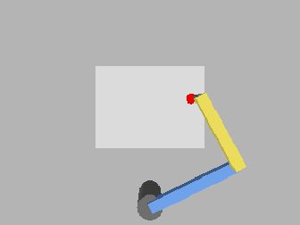
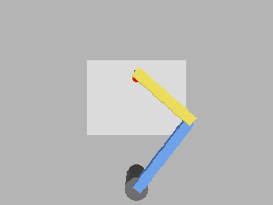
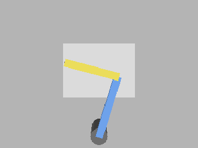

# Detecting The Red Marker

since in the image, we don’t have much colors, the ground is white, arms is black/gray/blue/yellow I’ve decided to find the red marker by averaging all the “red”-ish point, a red-ish point is the a point when in its RGB format the red value is > 150 and both green and blue are < 10, If none matches it skip and try in next timer tick.

```python
    def _get_red_marker(self, rgb_img):
        red_color_mask = (rgb_img[:, :, 0] > 150) & (rgb_img[:, :, 1] < 10) & (rgb_img[:, :, 2] < 10)
        ys, xs = np.where(red_color_mask)
        if xs.size == 0 or ys.size == 0:
            return None
        x = int(round(float(xs.mean())))
        y = int(round(float(ys.mean())))
        return x, y
```

# Finding Red Marker’s Depth

We sample a `5×5` window around the red marker's center pixel (filtering out non-finite, non-positive) and take the **median** as the marker's depth. We use the median rather than the average because its less affect by big changes, this helps us to ignore pixel which are on the edges or with slight bumps over the marker, the average would change heavily by those while median not. if None found skip and try next timer tick (which can happens if the arm cover the red marker)

```python
    def _get_pixel_depth(self, u, v, depth_img, radius=2):
        h, w = depth_img.shape[:2]
        u0 = max(0, u - radius)
        v0 = max(0, v - radius)
        u1 = min(w, u + radius + 1)
        v1 = min(h, v + radius + 1)
        around_pixel = depth_img[v0:v1, u0:u1]
        filterred = around_pixel[np.isfinite(around_pixel) & (around_pixel > 0.0)]
        if filterred.size == 0:
            self.get_logger().debug(f"Failed to find pixels with valid values around point: [{u}, {v}]")
            return None
        return float(np.median(filterred))
```

# TF Direction And Timing

After finding out the red marker location using the `camera_optical_frame` cors we need to transfer it into `base_link` cors, we do so using the function:

```python
    def transform_camera_cors_to_base_link(self, pointStamped):
        point_as_base_link_cors = None
        try:
            point_as_base_link_cors = self.tf_buffer.transform(pointStamped, 'base_link', timeout=Duration(seconds=0.2))
        except TransformException as ex:
            self.get_logger().warn(f'Failed to transform {pointStamped.header.frame_id} -> base_link: {ex}',)
        return point_as_base_link_cors

```

Then we add 0.08m to its Z axis because we want to be above the red marker and not crash it while moving.

The direction of the transformation is from the `camera_optical_frame`  and stored in the `pointStamped.header.frame_id` to the `base_link` because the `ArmClient` expects its input to be from the robot `base_link` . We set a timeout of 0.2s to the transformation because if its exceed  the transformation isn’t ready yet, so we'd rather retry on the next tick rather than block incase something will change in the world.

For the timing, we first distinguished between 2 types of clocks:

1. Simulator time (`use_sim_time=True`)
2. wall clock time (`wall_time`)

As requested, all calculations use simulation time (except one noted below), so our node will use the simulator time, we add this snipped to the code at its `__init__`  (which declares it if needed and sets it to True):

```python
        # make sure 'use_sim_time' is True
        if not self.has_parameter('use_sim_time'):
            self.declare_parameter('use_sim_time', True)
        else:
            self.set_parameters([Parameter('use_sim_time', Parameter.Type.BOOL, True)])
```

The calculations we are doing are:

1. Timer ticks - we are adding a timer that ticks every `50ms`

```python
        # create a timer that runs every 50ms
        self.timer = self.create_timer(0.05, self.run_logic)
```

2. Syncing between RGB & depth images of the camera  - we accept only pairs such that their timestamps has a difference by at most `50ms`

```python
        rgb_ns = stamp_to_ns(latest_rgb.header.stamp)
        depth_ns = stamp_to_ns(latest_depth.header.stamp)
        diff_ns = abs(rgb_ns - depth_ns)
```

3. Validate that the pair is relative new regarding to the simulation timer - we don’t want to act on image pairs that are too out of date in the simulator timestamps.

```python
        # Check if pair is too old ( > 0.5s)
        rgb_ns = stamp_to_ns(rgb_msg.header.stamp)
        depth_ns = stamp_to_ns(depth_msg.header.stamp)
        obs_sim_ns = max(rgb_ns, depth_ns)
        now_sim_ns = self.get_clock().now().nanoseconds
        if now_sim_ns <= 0:
            self.get_logger().warn("Simulation clock not active yet.")
            return None
        sim_age_ns = now_sim_ns - obs_sim_ns
        if sim_age_ns > MAX_OBS_SIM_AGE_NS:
            self.get_logger().debug("Imgs pair too old (>0.5s), skipping...")
            return None
```

4. Validate that we have a fresh camera data with the 2 seconds of wall time (not the simulator), we do so by storing on each camera img update (`_on_rgb_update` and `_on_depth_update`)  the current timestamps, and compare it when getting the pairs using:

```python
        # Check if data fresh (< 2s)
        now_wall = time.monotonic()
        if self._last_cam_wall_time is None or (now_wall - self._last_cam_wall_time) > 2.0:
            self.get_logger().warn("No fresh camera data within 2s, skipping..")
            return None
```

5. Once we schedule an action to the move client or it’s already finished, we don’t want to repeatedly send to the arm actions that point until it reaches it (or even after if its the same point) that is why we guard our`self.arm.move_to_point` action with 2 checks,
    1. Check if there is a running action (`self.motion_future`)
    2. Check if we already reached the target point (`self._already_there` )

# Failure Handling

In general, because we have a timer that ticks our logic every 50ms the error-handling logic is to fail silently and try the operation again on the next tick” from “fresh start”. Since there are can be a failure point almost every where I’ll mark here the important ones I’ve encountered:

### Camera Sync Issues

The camera contains 3 publisher, and each of those can have different starting time and publish rate, that is why in the `get_current_image` I’ve validated that we have depth and RBG images available and that are published recently (images are up to date). The 3rd publisher for the camera info might not have data yet and that’s why we validate for its `None` value in `run_logic`. Note that the camera is static in the world so I don’t have to store its location or make sure it is within the same timestamp as the images.

### Detect & Constructing 3D Point Issues

Once we have a valid images and camera info, we might fail in the process of constructing the 3d point. possible steps are

- Image has no valid red pixels (because we cover the red marker completely or camera colors issue in the RBG image for example)
- Transformation issues, the transformation itself might not be ready yet since not all frames are ready yet or its result is indeed a point but for some reason we got other `frame_id` than expected (`base_link`), for example:

```bash
Failed to transform camera_optical_frame -> base_link: "base_link" passed to lookupTransform argument target_frame does not exist.
Failed to transform camera_optical_frame -> base_link: "camera_optical_frame" passed to lookupTransform argument source_frame does not exist.
```

- After constructing a point we validate that the goal is safe to execute (for example, checking that z is within `±0.01 m` of `0.14 m` , `frame_id == 'base_link'` , and coordinates are finite)

### Moving The Robotic Arm

The robotic arm has several limitation that we should act on like:

- Arm is not ready
- We can’t send multiple move actions (hence we store the future)
- The move action it self can fail

# Build The Package Line

run under the folder `solution`  at `my_solution`

```bash
colcon build --symlink-install
source install/setup.bash
```

# Run The Solution

```bash
ros2 run solution marker_reacher
```

to see debug logs:

```bash
ros2 run solution marker_reacher --ros-args --log-level marker_reacher:=debug
```

# Tests Result

```bash
tsn0w@tsn0w:~/Documents/robotics/robotics-course-HW/assignments/hw01/my_solution/solution$ ros2 run hw01_sim check_reach --preset 1
PASS: tip error 0.0012 m, held 2 simulated seconds; live contact streams clear
```


```bash
tsn0w@tsn0w:~/Documents/robotics/robotics-course-HW/assignments/hw01/my_solution/solution$ ros2 run hw01_sim check_reach --preset 2
PASS: tip error 0.0038 m, held 2 simulated seconds; live contact streams clear
```


```bash
tsn0w@tsn0w:~/Documents/robotics/robotics-course-HW/assignments/hw01/my_solution/solution$ ros2 run hw01_sim check_reach --preset 3
PASS: tip error 0.0028 m, held 2 simulated seconds; live contact streams clear
```

