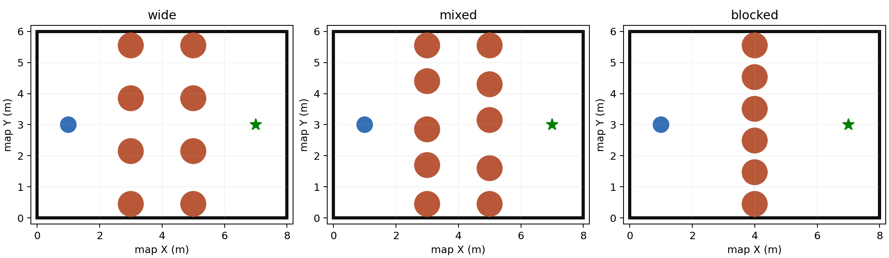

# HW2: Configuration Space, PRM and A*

**Draft: release checks are still pending.**

## Goal

Plan a route for a circular robot across a room containing pillars. Some gaps
are physically too small; others allow the robot to pass. Construct configuration
space, build a Probabilistic Roadmap (PRM), and use A* **on the roadmap graph**.
Then execute your selected waypoints with the provided single-destination helper.

You implement planning and waypoint sequencing. We provide the map, perfect
simulation localization, and low-level movement. There is no SLAM, perception,
Nav2 integration, or controller implementation in this assignment.

## Before starting

Follow [the setup guide](environment/README.md). Run the shared readiness check
and both examples in [my_solution](my_solution/README.md). Restart the world
before demonstrating your planner. Create your own ROS 2 Python package;
the examples are installation checks, not assignment starter solutions.

## Robot and rooms

The complete robot footprint, including its wheels, fits within a circle of
radius **0.25 m**. Add a **0.05 m safety margin**, so plan using radius **0.30 m**.
The robot can turn in place. Its collision footprint does not change with heading,
so the planning configuration is `(x, y)`. The helper handles heading changes.

The room interior is 8 × 6 m, with `map` coordinates X=0…8 and Y=0…6.
Start and goal are supplied on ROS topics, initially `(1, 3)` and `(7, 3)`.
Pillars have radius 0.40 m and height 1 m. The green floor goal is not an obstacle.

{width=100%}

| Layout | Intended behavior |
| --- | --- |
| `wide` | Find and execute a route through wide passages. |
| `mixed` | Distinguish blocked gaps from passable gaps and execute a route that changes direction. |
| `blocked` | Report no roadmap path within a finite sampling budget and keep the robot stopped. |

Obstacle coordinates are visible in the environment for reproducibility. Your
planner must use the received map, start, and goal rather than hardcoded routes
or branches that depend on the layout name.

## Interfaces

| Topic/action | Message type |
| --- | --- |
| `/map` | `nav_msgs/msg/OccupancyGrid` |
| `/hw02/start`, `/hw02/goal` | `geometry_msgs/msg/PoseStamped` |
| `/hw02/robot_pose` | `geometry_msgs/msg/PoseStamped` |
| `/hw02/robot_velocity` | `geometry_msgs/msg/Twist` |
| `/clock` | `rosgraph_msgs/msg/Clock` |
| `/tf` | `tf2_msgs/msg/TFMessage` |
| `/hw02/go_to` | `hw02_interfaces/action/GoTo` |
| `/hw02/contacts` | `ros_gz_interfaces/msg/Contacts` |
| `/hw02/collision` | `std_msgs/msg/Bool` |

The raw map has resolution 0.025 m, width 320, height 240, and identity origin at
`(0, 0)`. Values are 0 (free) or 100 (occupied); treat unknown values as occupied.
Its boundary cells are occupied. A cell is occupied if it intersects an obstacle,
so it conservatively represents physical geometry. **The supplied map is not
configuration space and contains no robot-radius inflation.**

Map indexing is row-major: `data[row * width + column]`. Column corresponds to X,
row to Y; use the map origin and resolution for world/grid conversion. Array
plotting defaults may place row zero at the top—ensure your figure uses the same
coordinates as Gazebo. Map and static-target subscribers must use reliable,
transient-local QoS so that late subscribers receive them.

Measured pose is ground truth in `map`; TF publishes `map` → `base_link`. The
velocity observer publishes world X/Y linear velocities and Z angular velocity.
Enable `use_sim_time` in your node. Contacts with walls/pillars are latched until
restart; floor contact is normal and excluded. Missing contact messages are not
proof of a collision-free run.

## Required implementation

1. Build configuration space from the raw occupancy map. Account for the full
   0.30 m planning radius, occupied-cell area, unknown cells, and room boundaries.
2. Sample free configurations, then connect neighbors to build a PRM. Check
   **every edge along its entire length**, not just its endpoints. Reject edges
   that touch occupied configuration-space cells or leave the map.
3. Connect the supplied start and goal to the roadmap and run A*. Use Euclidean
   edge lengths as costs and Euclidean distance to the goal as the heuristic.
4. Execute your route by calling `go_to(x, y)` for each waypoint. Await success
   before requesting the next waypoint; stop the sequence after any failure.
5. Use finite sampling/retry limits. If no roadmap path is found, report it and
   leave the robot stopped. Never execute a partial route toward a disconnected goal.

Sampling count, neighbor count, connection limits, and retry policy are your
choices; document them. Use reproducible random seeds. Do not import reference
planners or replace your PRM/A* implementations with a library planner.

A finite roadmap that has no route does **not generally prove** that the physical
room is impossible. Narrow passages may need more samples. Distinguish this
sampling limitation from the known blocked demonstration room.

## Movement helper

`RobotClient.go_to(x, y)` returns an asynchronous result with `success` and
`message`. See the student README for usage. Keep spinning the ROS executor;
do not block a subscription callback waiting for a result.

Coordinates are metres in `map`. The action itself takes a `PointStamped` in
`map` with z=0. Goals must be finite and leave room for the physical footprint at
the walls. The helper does not check your inflated map, find routes, or avoid
pillars. **An obstructed direct go-to can collide and fail.** Planning is your job.

The helper limits speed to 0.20 m/s and 0.8 rad/s, arrives within 0.02 m, and
commands zero velocity before success. It rejects concurrent requests and stops
on cancellation, stale feedback/contact monitoring, stalled simulation, or a
120-wall-second destination timeout. The client has a 130-second response deadline.
A Gazebo watchdog zeros commands that have not been refreshed for 0.5 wall seconds.
After contact, restart the simulation. Cancel pending movement on interruption.

Only one-destination movement is provided. No full-path action/helper is supplied.

## Visualizations and evaluation

Publish these student outputs in `map`:

| Student output | Type and purpose |
| --- | --- |
| `/hw02/cspace` | `nav_msgs/msg/OccupancyGrid`; inflated map, same metadata, reliable/transient-local |
| `/hw02/roadmap` | `visualization_msgs/msg/MarkerArray`; samples and accepted edges, reliable/transient-local |
| `/hw02/planned_path` | `nav_msgs/msg/Path`; ordered start-to-goal route, reliable/transient-local |
| `/hw02/planner_status` | `std_msgs/msg/String`; reliable/transient-local status |

Use statuses `planning`, `path_found`, `executing`, `completed`, `no_path_found`,
and `failed` as appropriate. Publish `no_path_found` for the blocked demonstration;
keep your node alive for at least three simulated seconds afterward so the observer
can verify stationary behavior. The planned-path topic is visualization only.

Save figures showing configuration-space obstacles, samples, roadmap edges,
start/goal and selected path. For a no-path run, show the roadmap without a fabricated
route. Compare the physical map with configuration space and explain which gaps
close when the robot footprint is considered.

Start the [public observer](tests/README.md) **before** your implementation.
For each solvable room it independently checks arrival within **0.10 m**,
stopped for **two simulated seconds**, with fresh physics data and no wall/pillar
contact. For the blocked room it checks no-path status and no movement. An action
success alone does not pass this check.

## Deliverables and submission

Submit your ROS package and `report.md` under `my_solution/`. Include:

- Exact build/run commands, declared dependencies, and readiness results.
- Configuration-space/roadmap/path figures for all three layouts.
- Planning results for seeds **0, 1, and 2** in each solvable layout: sampling and
  neighbor settings, retries, planning time, nodes/edges, path length, and execution outcome.
- A bounded no-path result for `blocked` and discussion of sampling limitations.
- One short recorded demonstration per layout, with simulation and public-check results.

Reports/figures are submitted source material, not environment build output.
Keep large recordings outside Git and include accessible links. Teaching staff
will announce the deadline and grading weights before release.

Follow the [repository submission process](../../README.md#submitting-an-assignment).
Use one `hw02` branch and one PR per student/group. Title it
`HW02 — Firstname Lastname` or include all submitting students' names.

The TA schedules a 10–15 minute live demonstration approximately one week after
submission. All group members attend and must explain configuration space, edge
checking, PRM parameters, A* behavior, waypoint sequencing, and failure handling.
